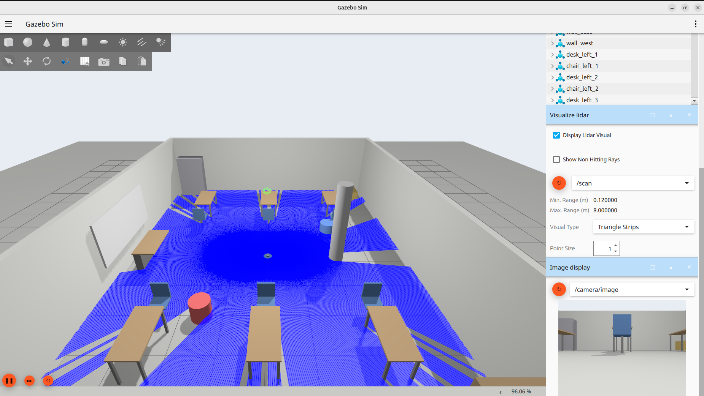
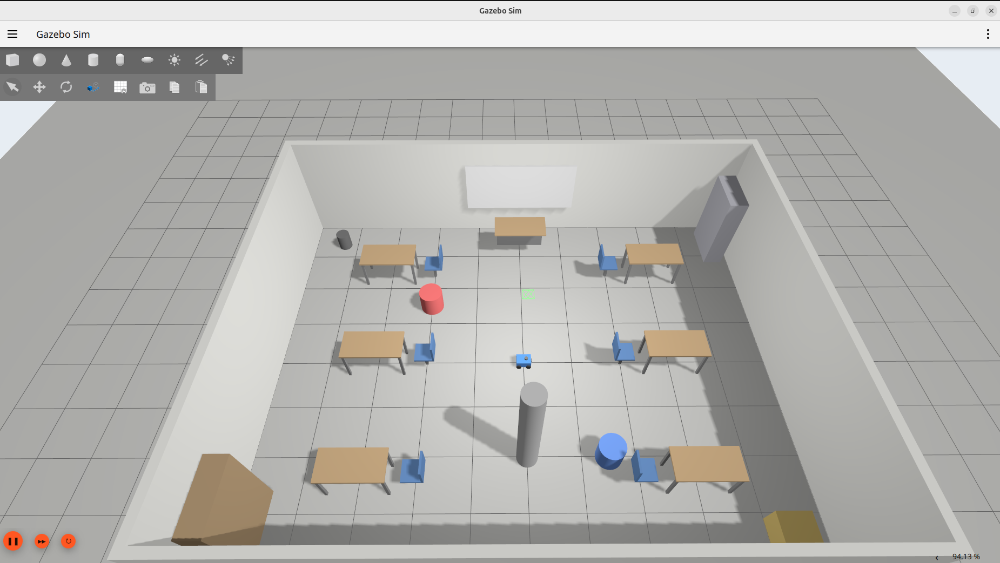
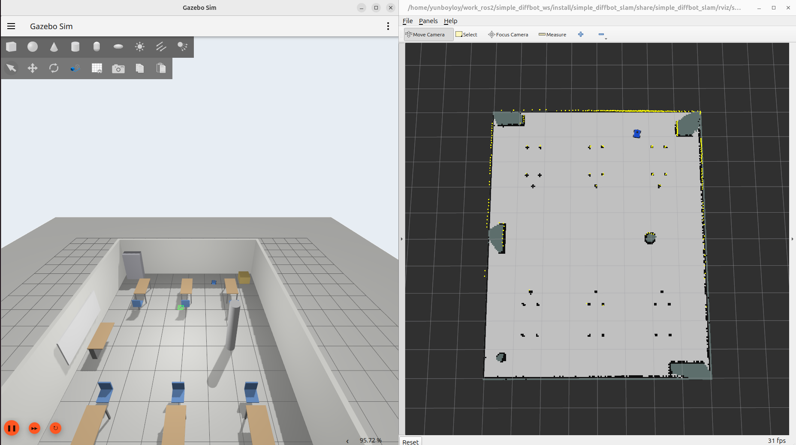
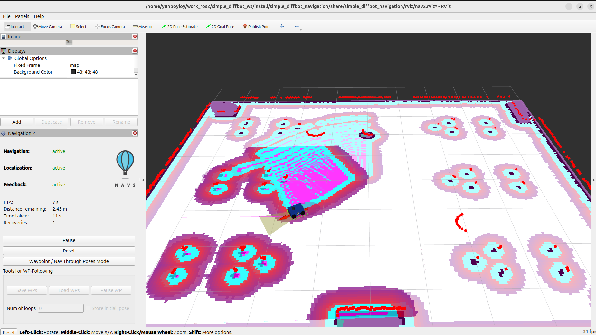
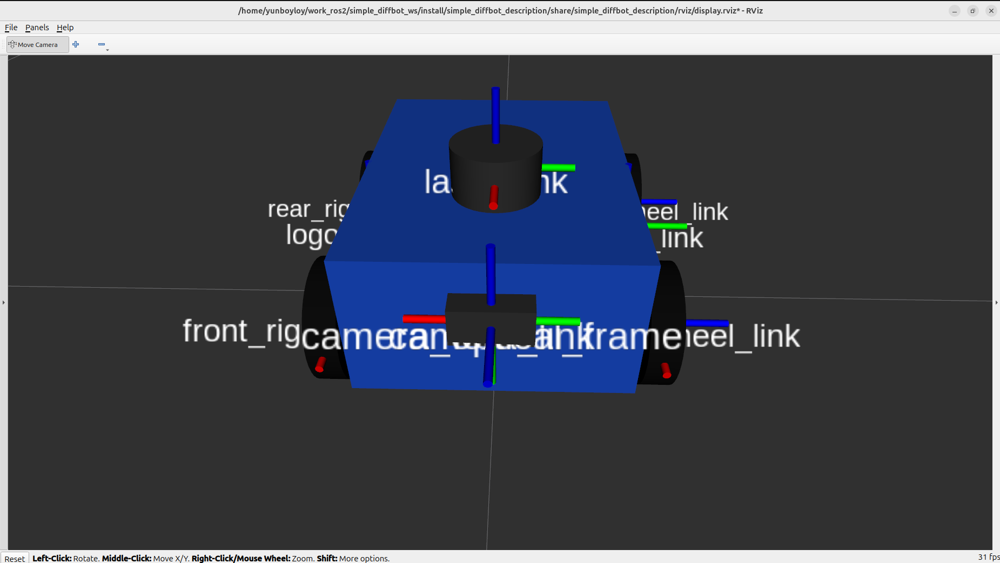
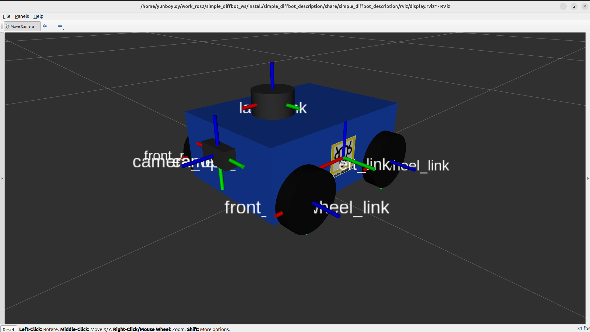
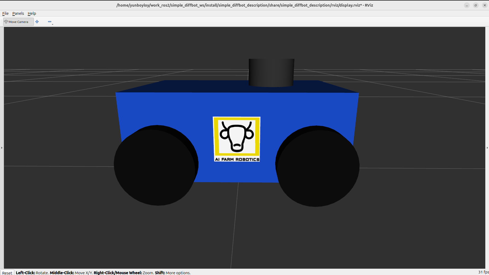

<p align="center">
  
</p>

<h1 align="center">Simple 4WD Diffbot</h1>

<p align="center">
  <em>A four-wheel differential-drive robot that maps, localizes and navigates on ROS 2 Jazzy and Gazebo Harmonic.</em>
</p>

<p align="center">
  <a href="#quick-start"><b>Quick start</b></a> ·
  <a href="#it-does-things">Demos</a> ·
  <a href="#packages">Packages</a> ·
  <a href="#workflow">Workflow</a> ·
  <a href="#troubleshooting">Troubleshooting</a>
</p>

<p align="center">
  
  
  
  
</p>

---

**This repo is the robot's whole stack.** ROS 2 workspace for a simple four-wheel differential-drive
(skid-steer) educational robot, simulated in Gazebo Harmonic. It covers the full mobile-robot pipeline:
robot model, simulation, teleoperation, SLAM mapping, localization and autonomous navigation with Nav2.

## It does things

<table>
<tr>
<td width="50%">
  <video src="docs/videos/mapping.mp4" controls width="100%"></video>
</td>
<td width="50%">
  <video src="docs/videos/nav2_pure_pursuit.mp4" controls width="100%"></video>
</td>
</tr>
<tr>
<td><b>It maps.</b> Drive with the PS4 controller and <code>slam_toolbox</code> builds the classroom map. <a href="docs/videos/mapping.mp4">Open video</a></td>
<td><b>It follows a path.</b> Nav2 with Regulated Pure Pursuit: clean and light on CPU, best in open space. <a href="docs/videos/nav2_pure_pursuit.mp4">Open video</a></td>
</tr>
<tr>
<td width="50%">
  <video src="docs/videos/nav2_dwb_dynamic_obstacle.mp4" controls width="100%"></video>
</td>
<td width="50%">
  <video src="docs/videos/nav2_mppi_dynamic_obstacle.mp4" controls width="100%"></video>
</td>
</tr>
<tr>
<td><b>It dodges (DWB).</b> Navigating around a moving obstacle with the DWB controller. <a href="docs/videos/nav2_dwb_dynamic_obstacle.mp4">Open video</a></td>
<td><b>It dodges (MPPI).</b> The same test with the MPPI controller, which swerves earlier and moves more smoothly. <a href="docs/videos/nav2_mppi_dynamic_obstacle.mp4">Open video</a></td>
</tr>
</table>

| | |
|---|---|
|  |  |
|  |  |

## Contents
- [Demos](#it-does-things)
- [Requirements](#requirements)
- [Packages](#packages)
- [Build](#build)
- [Quick start](#quick-start)
- [Workflow](#workflow)
- [TF tree](#tf-tree)
- [Key topics](#key-topics)
- [Robot summary](#robot-summary)
- [Repository layout](#repository-layout)
- [Troubleshooting](#troubleshooting)
- [License](#license)

## Requirements
- Ubuntu 24.04 with **ROS 2 Jazzy**
- **Gazebo Harmonic** (installed with `ros-jazzy-ros-gz`)
- A GPU or working OpenGL stack (the LiDAR and camera use `ogre2` rendering)
- Optional: a PS4 controller for teleoperation

ROS packages used: `ros_gz_sim`, `ros_gz_bridge`, `xacro`, `robot_state_publisher`, `joint_state_publisher_gui`,
`rviz2`, `robot_localization`, `slam_toolbox`, `navigation2`, `nav2_bringup`, `joy`.

Install the dependencies from the workspace:
```bash
cd ~/work_ros2/simple_diffbot_ws
sudo apt update
rosdep install --from-paths src --ignore-src -r -y
```

## Packages
| Package | Purpose | README |
|---|---|---|
| `simple_diffbot_description` | URDF/Xacro model, Gazebo plugins and sensors (LiDAR, IMU, RGB-D camera), RViz view | [README](src/simple_diffbot_description/README.md) |
| `simple_diffbot_gazebo` | Gazebo worlds (classroom, empty), robot spawn, ROS-Gazebo bridge | [README](src/simple_diffbot_gazebo/README.md) |
| `simple_diffbot_teleop` | PS4 controller teleoperation (`/joy` to `/cmd_vel`) | [README](src/simple_diffbot_teleop/README.md) |
| `simple_diffbot_slam` | `slam_toolbox` online async mapping and the saved maps | [README](src/simple_diffbot_slam/README.md) |
| `simple_diffbot_localization` | EKF (wheel odometry + IMU) and AMCL with `map_server` | [README](src/simple_diffbot_localization/README.md) |
| `simple_diffbot_navigation` | Nav2 with a selectable controller: MPPI, DWB or Regulated Pure Pursuit | [README](src/simple_diffbot_navigation/README.md) |

Dependency order: `description` -> `gazebo` -> `teleop` / `localization` -> `slam` -> `navigation`.

## Build
```bash
cd ~/work_ros2/simple_diffbot_ws
source /opt/ros/jazzy/setup.bash
colcon build --symlink-install
source install/setup.bash
```
Build a single package with `--packages-select <name>`. After saving a new map into a package, rebuild
so it is installed.

## Quick start
Run each command in its own terminal, and `source install/setup.bash` in each one first.

```bash
# 1. View the model only (no simulation)
ros2 launch simple_diffbot_description display.launch.py

# 2. Simulation
ros2 launch simple_diffbot_gazebo gazebo.launch.py

# 3. Drive it
ros2 launch simple_diffbot_teleop ps4.launch.py
```

## Workflow
### 1. Simulate
```bash
ros2 launch simple_diffbot_gazebo gazebo.launch.py                 # classroom world
ros2 launch simple_diffbot_gazebo gazebo.launch.py world:=empty.sdf
```
Spawn pose can be set with `x`, `y` and `yaw`.

### 2. Map (SLAM)
```bash
ros2 launch simple_diffbot_localization ekf.launch.py     # odom -> base_footprint TF
ros2 launch simple_diffbot_slam slam.launch.py            # slam_toolbox + RViz + PS4 teleop
```
Drive around the whole room with the PS4 controller, then save the map:
```bash
ros2 run nav2_map_server map_saver_cli -f ~/work_ros2/simple_diffbot_ws/src/simple_diffbot_slam/maps/my_map
```
Rebuild afterwards so the new map is installed.

### 3. Navigate
```bash
ros2 launch simple_diffbot_gazebo gazebo.launch.py
ros2 launch simple_diffbot_navigation bringup.launch.py controller_type:=mppi
```
This starts localization (EKF + `map_server` + AMCL), the Nav2 servers and RViz. In RViz, set the initial
pose with **2D Pose Estimate**, then send a goal with **Nav2 Goal**.

| Argument | Default | Description |
|---|---|---|
| `controller_type` | `mppi` | `mppi`, `dwb` or `pure_pursuit` |
| `map` | `simple_diffbot_slam/maps/class_room.yaml` | Map to navigate in |
| `localization` | `true` | Set `false` if you start localization yourself |
| `rviz` | `true` | Open RViz with the Nav2 view |

### 4. Localization only
```bash
ros2 launch simple_diffbot_localization localization.launch.py    # EKF + map_server + AMCL
```

### 5. Moving obstacles (optional)
```bash
bash src/simple_diffbot_gazebo/scripts/patrol_obstacle.sh 0.5 8   # speed m/s, seconds per leg
```
Useful for comparing the three Nav2 controllers.

## TF tree
```
map -> odom -> base_footprint -> base_link -> (wheel links, laser_link, imu_link, camera_link -> camera_optical_frame)
```
| Transform | Published by |
|---|---|
| `map -> odom` | `slam_toolbox` (mapping) or AMCL (navigation) |
| `odom -> base_footprint` | EKF in `simple_diffbot_localization` (the Gazebo DiffDrive plugin has `publish_odom_tf=false`) |
| `base_footprint -> ...` | `robot_state_publisher` |

Without the EKF the `odom` frame is missing, and SLAM and Nav2 will not work.

## Key topics
| Topic | Type | Source |
|---|---|---|
| `/cmd_vel` | `geometry_msgs/Twist` | Teleop or Nav2 (via the collision monitor), into Gazebo |
| `/odom` | `nav_msgs/Odometry` | Gazebo DiffDrive |
| `/odometry/filtered` | `nav_msgs/Odometry` | EKF |
| `/scan` | `sensor_msgs/LaserScan` | Gazebo LiDAR |
| `/imu` | `sensor_msgs/Imu` | Gazebo IMU |
| `/camera/image_raw`, `/camera/depth_image`, `/camera/points`, `/camera/camera_info` | Image, PointCloud2, CameraInfo | Gazebo RGB-D camera |
| `/map` | `nav_msgs/OccupancyGrid` | `slam_toolbox` or `map_server` |
| `/clock` | `rosgraph_msgs/Clock` | Gazebo |

All nodes run with `use_sim_time:=true`.

## Robot summary
| | |
|---|---|
| Drive | 4 driven wheels, skid-steer (left pair / right pair) |
| Chassis | 0.30 x 0.22 x 0.12 m, 3.0 kg |
| Wheels | radius 0.05 m, width 0.025 m, track 0.255 m |
| Speed limits | 1.0 m/s and 2.0 rad/s in Gazebo; Nav2 limits to 0.4 m/s and 1.5 rad/s |
| LiDAR | 2D, 360°, 640 samples, 0.12 to 8 m, 30 Hz |
| IMU | 50 Hz |
| Camera | RGB-D, 320 x 240, 80° FOV, 15 Hz |

See [`simple_diffbot_description`](src/simple_diffbot_description/README.md) for the full model details.

| | | |
|---|---|---|
|  |  |  |

## Repository layout
```
simple_diffbot_ws/
├── src/                      # the six ROS 2 packages
├── docs/
│   ├── images/               # banner, screenshots, rosgraph.png (node/topic graph)
│   ├── videos/               # demo videos: mapping, Nav2 pure pursuit / DWB / MPPI
│   └── frames01.pdf          # generated TF tree
├── maps/                     # extra saved map (classroom.yaml / .pgm)
└── README.md
```
`build/`, `install/` and `log/` are generated by `colcon` and are not committed.

## Troubleshooting
| Problem | Fix |
|---|---|
| No `/scan`, `/imu` or camera data | The world must load the Sensors and Imu systems (the provided worlds do) and `ogre2` rendering must work |
| `odom` frame missing, SLAM or Nav2 reports TF errors | Start the EKF: `ros2 launch simple_diffbot_localization ekf.launch.py` |
| Time or "extrapolation into the future" errors | Use `use_sim_time:=true` on every node |
| New map not found by navigation | Rebuild (`colcon build --symlink-install`) and `source install/setup.bash`, or pass `map:=/full/path/to/map.yaml` |
| Robot not visible in the Gazebo GUI | Keep `gui_after_spawn:=true`, or raise `gui_delay` |
| Odometry yaw is wrong when turning | Calibrate `skid_steer_factor` in the description package |
| PS4 controller not detected | Check `ls /dev/input/js*` and `ros2 topic echo /joy` |

## License
Apache-2.0 (see the `LICENSE` file in each package).
